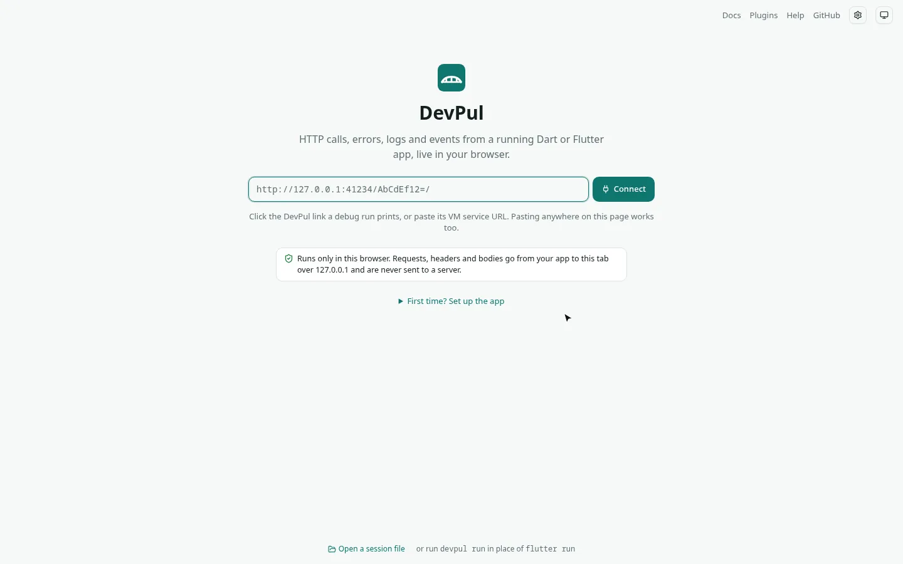

# DevPul

Debug bridge between a running Dart or Flutter app and your browser. The app sends HTTP calls, errors, logs, routes and custom events; the browser shows them live. No proxy, no certificates, no server. Pul means bridge in Nepali.

**Open the UI: [devpul.saradgajurel.com.np](https://devpul.saradgajurel.com.np)**

<picture>
  <source media="(prefers-color-scheme: dark)" srcset="apps/docs/public/screenshots/session-dark.webp">
  
</picture>

Everything runs in your browser. Requests, headers and bodies go from your app to the DevPul tab over `127.0.0.1` and are never sent to a server.

**Docs: [getting started](https://devpul.saradgajurel.com.np/docs/), [IDE setup](https://devpul.saradgajurel.com.np/docs/ide/), [command line](https://devpul.saradgajurel.com.np/docs/cli/), [extending](https://devpul.saradgajurel.com.np/docs/extend/), [plugins](https://devpul.saradgajurel.com.np/docs/plugins/install/), [agents (MCP)](https://devpul.saradgajurel.com.np/docs/mcp/), [tests](https://devpul.saradgajurel.com.np/docs/testing/), [security](https://devpul.saradgajurel.com.np/docs/security/), [limits](https://devpul.saradgajurel.com.np/docs/limits/), [help and FAQ](https://devpul.saradgajurel.com.np/docs/help/).** Sources in [apps/docs](apps/docs).

## How it works

The app posts events with `dart:developer` `postEvent`. They travel on the VM service Extension stream that every debug run already has. The browser connects to the Dart Development Service (DDS) websocket on `127.0.0.1` and reads them. Release builds have no VM service, and DevPul never emits in them. Profile builds leave DevPul out unless built with `--dart-define=DEVPUL_PROFILE=true`.

Works with Flutter on Android, iOS, desktop and web, and with plain Dart programs. Any state management through [observers](https://devpul.saradgajurel.com.np/docs/extend/), any HTTP client through adapters, and dart:io calls with no adapter.

## Quick start

1. Add the packages:

   ```yaml
   dependencies:
     devpul: ^1.1.0
     devpul_dio: ^1.1.1 # Dio
     devpul_http: ^1.1.0 # package:http
     devpul_flutter: ^1.1.0 # Flutter errors, debugPrint and routes
   ```

2. Hook them up:

   ```dart
   void main() {
     DevpulFlutter.install();
     Devpul.session({'name': 'My app', 'version': '1.0.0', 'flavor': 'dev'});
     dio.interceptors.add(DevpulDioInterceptor());
     runApp(
       MaterialApp(
         navigatorObservers: [DevpulNavigatorObserver()],
         home: const Home(),
       ),
     );
   ```

3. Run the app with the command line in place of `flutter run`; it opens DevPul connected to the app:

   ```sh
   dart pub global activate devpul_cli
   devpul run
   ```

   Any other debug run prints a link that opens DevPul in DevTools, connected to it, and IDEs show DevPul as a DevTools extension.

The [example app](examples/devpul_example) uses every package.

## Packages

| Package                                                   | What it does                                                                                                                                           |
| --------------------------------------------------------- | ------------------------------------------------------------------------------------------------------------------------------------------------------ |
| [devpul](https://pub.dev/packages/devpul)                 | Pure Dart core: `Devpul.session`, `tags`, `emit`, `log`, `error`, `action`, config, `DevpulHttp` for adapters. Web compatible.                         |
| [devpul_dio](https://pub.dev/packages/devpul_dio)         | `DevpulDioInterceptor` for Dio.                                                                                                                        |
| [devpul_http](https://pub.dev/packages/devpul_http)       | `DevpulClient` for package:http.                                                                                                                       |
| [devpul_flutter](https://pub.dev/packages/devpul_flutter) | Flutter errors with diagnostics, `debugPrint` capture, `DevpulNavigatorObserver`, `DevpulApp` overrides.                                               |
| [devpul_cli](https://pub.dev/packages/devpul_cli)         | `devpul run` in place of `flutter run`; `devpul` serves the UI on 127.0.0.1; `devpul add` copies plugins into the app; `devpul mcp` for coding agents. |
| [devpul_test](https://pub.dev/packages/devpul_test)       | `DevpulTest.capture` writes a session file for each failing test, from `dart test` and `flutter test`.                                                 |

## In the browser

- HTTP table with live pending rows, sortable columns, a filter syntax (`status:4xx ms:>500 host:api -word`), tree or raw JSON, copy as curl or fetch, HAR export.
- Errors with stack traces and Flutter diagnostics, grouped by repeat, with the requests made just before.
- Logs, custom events, app actions you trigger from the UI, and plugins with tabs for app state, storage, databases and your own events.
- Several apps at once, history across reloads, session files to share, keyboard navigation.

`devpul mcp` gives coding agents the same requests, logs, errors and actions over [MCP](https://devpul.saradgajurel.com.np/docs/mcp/). A failing test writes what it recorded to a session file, to open in the UI or hand to an agent.

## Limits

- Debug builds, and profile builds that opt in. Never release builds.
- Events cross the VM service as JSON. Very large or very frequent events cost app memory and time; `maxValueLength`, `backlogSize` and `ignoreUrls` keep that bounded.
- Configuration does not cross isolates.

The [limits](https://devpul.saradgajurel.com.np/docs/limits/) page has the rest, and [DevPul, DevTools and talker](https://devpul.saradgajurel.com.np/docs/compare/) when another tool fits better.

## Development

```sh
npm install
npm run dev          # UI on http://localhost:5173
npm run dev -w apps/docs   # docs on http://localhost:4321/docs/
npm run check        # everything below
npm run check:dart   # dart format, analyze, tests (Chrome for the web tests)
npm run check:web    # prettier, oxlint, vitest, tsc, build
npm run format       # prettier --write
npm run screenshots  # docs, README and pub screenshots (needs img2webp)
dart run tool/release.dart 1.2.3   # bump versions, check changelogs and semver, print publish commands
```

The site URL and repository link live in `site.json`. Docs are a Starlight site in `apps/docs`. `npm run build:site` builds the whole site into `dist/`: the app at `/`, docs at `/docs/` and, with `DEVPUL_REGISTRY` set to the output of `npm run build:registry`, plugin pages at `/plugins/`. The Pages workflow deploys `npm run build:pages`: app and docs from the highest `v*` tag, the registry from main. It runs on `v*` and `<id>-v*` tags, registry changes on main and by hand.

## License

MIT
